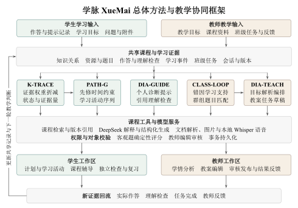

# 学脉 XueMai

**课程课后巩固与教师循证分层指导，让一道错题接上下一步学习。**

西安交通大学 · 软件工程 · 刘嘉程  
第九届传智杯 AI创新应用挑战赛 · 系统版本0.6.0

学生知道答案错了，却常常需要自己翻讲义、找视频、判断先补什么。教师面对全班作答，还要把共性困难转化为适合不同学生的练习，并持续查看后续结果。学脉把这些工作连接起来，让学习反馈对应到课程知识、可执行活动和教师任务。



学生从原题进入课程辅导，结合资料引用、操作实验和理解检查继续学习。教师从知识矩阵追溯实际作答，由独立教学助手组织教学环节，编辑教案、审核任务，再查看同一批学生的完成结果。K-TRACE估计知识状态，PATH-G安排先修与预算内路径，DIA-GUIDE支持个人辅导，CLASS-LOOP组织教学群组，DIA-TEACH编排教学方案。客观评分、课程权限与内容发布由业务服务执行。

当前以数据结构与算法、Python程序设计展示课程学习，分别提供31个与27个知识点、完整资料与题目、班级历史及六段原创教学视频。教师还可通过正常课程建设流程接入新单元，本次“信息素养微单元”已完成资料入库、学生辅导、练习、任务和教师反馈验证。演示账号与班级记录为合成教学数据，真实DeepSeek会话保留请求用量及教学结果。

技术文档、连续演示与可运行验证共同展示作品。学生端采用宋瓷青绿，教师端采用茶烟米褐，支持Flash/Pro、私有附件和本地语音输入。阅读[技术文档](docs/deliverables/xuemai-technical-report.pdf)，观看[1080p演示视频](docs/deliverables/xuemai-demo-1080p.mp4)，查看[方法与对照实验](docs/ALGORITHMS_V7.md)、[实际验证记录](docs/VALIDATION.md)和[框架图可编辑母版](docs/technical-report/figures/overall-framework.tex)。

## 人工审阅一键启动

在Windows中双击根目录的 **启动学脉.cmd**，前后端就绪后自动打开浏览器。首次启动会准备缺少的依赖，重复点击会复用本项目服务，单端退出时会补启该端。默认自动选择AI模式：后端配置有效Key时使用DeepSeek官方接口，无Key时使用Mock。离线检查可运行 `.\scripts\start.ps1 -MockAI`。

审阅地址为 http://127.0.0.1:5173 。账号student1和teacher的演示密码均为Xuemai123!。停止可在项目PowerShell运行 `powershell.exe -NoProfile -ExecutionPolicy Bypass -File scripts/stop.ps1`。

## 文件、模型与语音

师生问答支持Flash与Pro逐请求切换。Flash可读取图片，Pro使用文本与文档片段。TXT、Markdown、PDF、DOCX、CSV附件保存在当前用户的私有目录，回答中的引用可以打开原片段、版本和位置。附件绑定课程与会话。

当前开发机已准备本地Whisper small模型。其他电脑解压源码后，在已安装主依赖的环境运行 `powershell.exe -NoProfile -ExecutionPolicy Bypass -File scripts/setup-voice.ps1`，下载约483MB本地模型并安装可选语音依赖。模型缓存和临时音频由交付过滤规则排除。语音支持麦克风录音和音频上传，每段60秒以内，转写结果可编辑后发送。临时音频处理后删除。

## 每轮完整审阅包

每轮修改完成后，在根目录“交付审阅包”生成 `学脉XueMai_完整审阅包_年月日_时分秒.zip`，时间采用北京时间。每包收录当前源码、文档、现有视频、官方手册、本轮修改记录及补丁，以及本轮重新拍摄的全部前端模块截图，并生成“审阅包说明.md”和带SHA256的“审阅清单.json”。文档与视频各自的文件修改时间保留在清单中。

```powershell
node frontend/scripts/capture-review.mjs docs/rounds/本轮记录.md
.venv/Scripts/python.exe scripts/package_review.py --record docs/rounds/本轮记录.md --base-ref 本轮起始提交 --screenshots 交付审阅包/界面截图_年月日_时分秒
```

将命令参数替换为本轮修改记录、起始Git提交及截图脚本输出的实际目录。截图脚本使用1440×900、1366×768、1366×650、1920×1080桌面和390×844手机窄屏，覆盖登录页、学生端10个模块和教师端9个模块，并分别切换两门课程。桌面保存首屏，移动端长页面、长弹窗另存分段图，并拍摄分页、关键表单、题型、操作结果和AI引用。新增模块时维护 frontend/scripts/review-capture-plan.json 和对应操作。

截图使用本轮生产构建和独立合成演示数据，AI为本地Mock，真实API调用0次。隔离服务占用8002和5176端口，任务结束自动关闭，截图前会检查端口空闲。首次需完成环境安装，Windows使用已安装的Chrome，Linux需安装Playwright Chromium。

解压后先打开“界面截图/截图总览.html”查看缩略图并点击原图，也可用“截图索引.md”逐模块阅读。JSON清单记录模块、路由、状态、尺寸、SHA256和源码指纹。打包工具拒绝缺少模块、图片损坏、跨轮记录或与当前源码不一致的截图。

打包规则过滤凭据、依赖、运行数据、缓存、历史压缩包及既往审阅包，当前截图通过参数单独收录。完成ZIP和逐文件摘要校验后才生成可交付的ZIP。后续工程执行约定见AGENTS.md。

## 本机 10 分钟复现路径

Windows浏览器自动验收使用已安装的Google Chrome；Linux持续集成使用Playwright Chromium。

环境：Windows 10/11，Python 3.13，Node.js 20.18+，npm，Git。开发机实际使用 Python 3.13、Node 20.18、npm 10.8；使用 Vite 6 保持兼容。首次依赖下载受网络影响，不保证所有网络环境在 10 分钟内完成。

```powershell
git clone https://github.com/Sunny1004-7/xuemai-ai-platform.git
cd xuemai-ai-platform
.\scripts\setup.ps1
.\scripts\start.ps1
```

打开 [学脉本机应用](http://127.0.0.1:5173)；[接口说明](http://127.0.0.1:8000/docs)。停止：`.\scripts\stop.ps1`。没有远程权限时，也可以直接在当前工程运行 setup/start。

| 身份 | 账号 | 演示密码 |
|---|---|---|
| 教师 林知远 | teacher | Xuemai123! |
| 学生 陈星河 | student1 | Xuemai123! |

所有预置账号、掌握度、学习记录和班级均为**合成演示数据**。初始班级邀请码 XM2026；第二课程 Python 程序设计邀请码 PY2026。学生通过课程班级取得访问权限。

## 复现教学闭环

1. 教师登录，课程与班级创建课程、章节和班级，在图谱添加知识点和先修关系。
2. 题库与作业选择课程题目，发布到班级。学生登录后在练习页接收作业并提交。
3. 故意答错一次后查看错题；使用提示、独立复测，比较图谱掌握度和推荐理由变化。
4. 从题目打开学习伙伴，查看题目上下文、资料引用和流式回复，重新打开历史会话。
5. 在图谱选择冒泡排序并进入课程视频；字幕定位、时间戳笔记、随堂题写回学习记录。
6. 教师学情与分层页查看薄弱群组、发布巩固任务，学生完成后刷新统计。

交互实验室由算法执行排序、栈/队列、二叉树与 BFS；Python课程使用循环、分支、列表共享和函数调用四类受控实验，逐步展示变量与输出。课程资料支持文本/PDF解析；教师AI备课和出题先生成可编辑草稿，审核保存后才成为课程内容。

## AI 模式与额度

默认 `AI_MODE=auto`，后端有Key时使用DeepSeek，无Key时使用Mock；`AI_MODE=mock` 明确覆盖自动模式。辅导功能区显示当前模式。Mock为固定教学样例，常规回归、截图与录制预检使用Mock。正式演示保留既有官方响应和同一教学任务的连续操作。

正式按需使用：把 `.env.example` 中所需变量设置到后端环境，或保留已被忽略的根目录 `deepseek官方api.txt`，然后：

```powershell
$env:DEEPSEEK_API_KEY = '<仅本机设置，不写入代码>'
.\scripts\start.ps1 -RealAI
```

`.env.example` 是变量清单，启动器不会自动解析 `.env`。密钥只在后端读取。模型、输出上限、超时与每分钟请求数均集中配置，默认不重试。模型依据 [DeepSeek 官方接口](https://api-docs.deepseek.com/zh-cn/)选择 `deepseek-flash`，结构化生成按 [JSON Output 规范](https://api-docs.deepseek.com/zh-cn/guides/json_mode/)校验。

常规测试、CI、浏览器回归均 **0 次真实请求**。历史烟测3次、220 Tokens和第三轮辅导、出题、备课、量规评阅4次抽样账本保留；后者输入3744、输出724 Tokens，零重试。第四、第五轮未新增真实API调用。第六轮实际调用13次，Flash 10次、Pro 3次，输入16527、输出2540 Tokens，覆盖师生双角色、文档、图片、语音、出题、备课与评阅，全部成功。见[第六轮真实联调](docs/rounds/第六轮DeepSeek真实联调.json)。已有联调账本时脚本阻止重复执行；正式产品按正常教学请求调用，开发联调的次数上限不作为产品永久额度。历史结果见 [DeepSeek联调记录](docs/rounds/第三轮DeepSeek联调.json)。

## 结构与验证

```text
backend/app/        认证、课程、评分、证据、推荐、教师分析、AI
backend/migrations/ 版本化 SQLite SQL
backend/tests/      离线契约、权限与业务闭环测试
backend/media/      自有教学演示 MP4
frontend/src/       学生与教师 React 页面、算法组件
frontend/e2e/       真实浏览器教学闭环
scripts/           Windows 安装启动测试、安全扫描、显式烟测
docs/              架构、API、设计与真实开发过程
```

```powershell
.\scripts\test.ps1
# 首次浏览器测试若缺少 Chromium：
cd frontend
npx playwright install chromium
```

后端测试使用隔离临时数据库；端到端使用独立端口和演示数据库，不访问真实 AI。测试报告和截图生成在忽略的本机目录，核实结果后把不含敏感信息的必要证据存入 docs。

数据库默认 `data/xuemai.db`，启动自动迁移并执行版本化教学内容补全。5001导入双课样例，5002精修未被人工修改的原始对话和目标；重复启动保留编辑、作答及完成状态。不要在已有真实数据上删除数据库以“修复”；演示重建请另选 `DATABASE_PATH` 创建新库。六个原创教学片段已随源码提供，重建素材安装 `scripts/media-requirements.txt` 后执行 `scripts/generate_teaching_clips.py` 及 `scripts/generate_python_clips.py`。正式文档与系统演示的生成方式见[材料说明](docs/TECHNICAL_REPORT.md)和[演示分镜](docs/demo/讲解稿与分镜.md)。

## 使用边界与赛事证据

客观题按规则评分，简答按量规待教师复核；AI 草稿和辅导需核对。观看时长仅作为活动记录，不能直接代表掌握。上传资源按课程授权访问，任何真实学生数据应在适当授权后导入。

本项目面向本机演示，服务默认仅绑定 127.0.0.1。公开部署前需要 HTTPS、账号管理、正式运维与数据保护配置；演示账号不适合直接用于公网服务。

运行setup前先停止本项目服务，避免Windows占用esbuild可执行文件；安装器会检查端口并说明。重新生成PDF和演示素材时，安装scripts/requirements-tools.txt中的可选工具；这些依赖不影响应用启动。原始聊天自动快照对部分协作正文不完整，另提供可见协作卡片逐字转存与实际回放，建议保留原界面截图交叉核验。

真实阶段进度见 [PROJECT_STATE.md](PROJECT_STATE.md)，架构与接口见 docs。开发过程摘要区分真实用户指令和 Codex 自主分工，不伪造用户反馈；原始聊天导出/录屏需与摘要共同保留。参赛要求包括 5–8 分钟 1080p MP4（至少 2 分钟真实 AI 协同）和不超过 30 页技术 PDF；最终交付状态以 PROJECT_STATE 为准。
