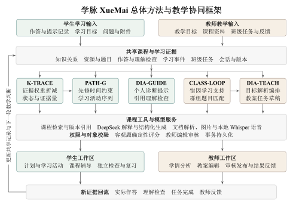

# 学脉 XueMai

　　学脉是一套面向学生与教师的AI个性化智慧教育平台。学生可以把课程资料、视频、练习与答疑连接起来，逐步弄清自己的困难和下一步学习安排。教师可以从具体作答理解班级差异，组织教学内容、发布针对性任务，并持续查看完成结果。

<p align="center">
  
</p>

　　本项目把个性化支持落实到能够直接进入的课程活动。知识状态综合得分、提示、重复作答与时间变化；学习规划同时考虑先修关系和可用时间；学生辅导通过资料引用与理解检查推进学习；教师助手则依据教学目标和班级证据形成可编辑方案。每次练习、审核和反馈都与原有课程对象保持关联，建议因而能够继续成为实际行动。

　　平台采用宋瓷青绿与茶烟米褐双主题，提供学生10个模块与教师9个模块。当前以数据结构与算法、Python程序设计展示课前、课中和课后的教学活动，分别配有31个和27个知识点、完整资料与题目、差异化班级记录，以及六段原创教学视频。教师还可通过正常课程建设流程接入新的主题。

　　阅读[技术文档](docs/deliverables/xuemai-technical-report.pdf)，观看[1080p演示视频](docs/deliverables/xuemai-demo-1080p.mp4)，查看[核心方法与实验](docs/ALGORITHMS_V10.md)、[实际验证记录](docs/VALIDATION.md)和[框架图可编辑母版](docs/technical-report/figures/overall-framework.tex)。

## 方法与验证

　　K-TRACE追踪知识证据，PATH-G规划先修和时间约束下的活动，DIA-GUIDE组织学生诊断、干预与理解检查，CLASS-LOOP形成错因关注群组，DIA-TEACH连接教师目标、班级证据和教学产物。五项方法的[中英文定义](docs/METHOD_TERMS.md)、实现与对照结果随源码提供。

　　本地实验采用开发与评测分离的固定数据。1200条学习轨迹比较知识追踪修正，180个独立图形成720种路径场景，48个班级检查分层，三课程180个问题检查检索。PATH-G先修与预算违规均为0，相对同约束可行贪心的平均效用提高2.80%，按独立图重采样的95%区间为2.15%—3.48%，逐例456胜、209平、55负。更充分地使用有限学习时间，是这一搜索机制带来的直接价值。

　　扩展实验完成202次真实DeepSeek请求、371,304 Token，其中80个独立任务形成160次配对响应。原编排和单步提示的初次业务完成分别为77/80与80/80。教学草稿包裹格式修复后，8个新主题任务全部形成有效方案并保存。教师发布、学生作答与结果回流均在隔离数据库执行。[实验协议、逐例结果与Token账本](docs/experiments/round10/README.md)保留初次失败及后续复核。

## 10分钟极速复现

　　环境要求为Windows 10/11、Python 3.13、Node.js 20.19+（建议22 LTS）、npm和Git。Windows浏览器验收使用Google Chrome，Linux持续集成使用Playwright Chromium。首次运行需要下载依赖。后端依赖见[requirements.txt](backend/requirements.txt)，前端依赖见[package.json](frontend/package.json)，环境变量见[.env.example](.env.example)。

```powershell
git clone https://github.com/Sunny1004-7/xuemai-ai-platform.git
cd xuemai-ai-platform
.\scripts\setup.ps1
.\scripts\start.ps1
```

　　Windows也可双击根目录的 **启动学脉.cmd**，前后端就绪后自动打开浏览器。重复启动复用本项目服务。默认应用地址为 [http://127.0.0.1:5173](http://127.0.0.1:5173)，[接口说明](http://127.0.0.1:8000/docs)位于8000端口。启动器检查端口归属，遇到其他工程占用会给出提示。停止本项目可执行 `powershell.exe -NoProfile -ExecutionPolicy Bypass -File scripts/stop.ps1`。

| 身份 | 账号 | 演示密码 |
|---|---|---|
| 教师 林知远 | teacher | Xuemai123! |
| 学生 陈星河 | student1 | Xuemai123! |

　　初始班级邀请码为XM2026，Python课程邀请码为PY2026。预置账号、掌握度、学习记录和班级为合成教学数据；学生通过课程班级取得访问权限。

　　默认端口被其他工程使用时，可选择空闲端口分别启动。以下两组命令在项目根目录的两个PowerShell终端执行，打开 [http://127.0.0.1:5180](http://127.0.0.1:5180) 即可。端口需保持前后对应。

```powershell
# 终端一，启动后端
.venv/Scripts/python.exe -m uvicorn backend.app.main:app --host 127.0.0.1 --port 8006
```

```powershell
# 终端二，启动前端
$env:VITE_API_PROXY_TARGET='http://127.0.0.1:8006'
Set-Location frontend
npm run dev -- --host 127.0.0.1 --port 5180 --strictPort
```

## AI、文件与语音

　　默认 `AI_MODE=auto`，后端读取有效Key后使用DeepSeek官方API，无Key时使用本地Mock。离线检查可执行 `.\scripts\start.ps1 -MockAI`。环境变量模板见[.env.example](.env.example)，启动器直接读取进程环境。

```powershell
$env:DEEPSEEK_API_KEY = '<仅在本机设置>'
.\scripts\start.ps1 -RealAI
```

　　密钥只在后端读取。师生AI支持Flash与Pro逐请求切换，Flash可读取图片，Pro使用文本与文档片段。TXT、Markdown、PDF、DOCX和CSV附件按用户、课程及会话保存，回答中的引用可以打开原片段、版本和位置。

　　语音使用可选的本地Whisper small模型，支持麦克风和60秒以内音频上传，转写文字可编辑后发送。其他电脑运行 `powershell.exe -NoProfile -ExecutionPolicy Bypass -File scripts/setup-voice.ps1` 准备可选依赖与约483MB模型。

　　模型调用采用统一Token账本，调用前预留输入与输出，返回后按官方usage结算。已完成实验的输入297,521、输出73,783 Token，Flash183次、Pro19次，明细见[统一账本](docs/experiments/round10/token-ledger.json)。常规测试、CI和截图使用Mock，材料构建直接读取已完成结果。

## 复现教学流程

1. 教师在课程与班级组织章节和班级，在知识图谱维护知识及先修关系。
2. 教师从题库与作业发布任务，学生独立作答并查看解析与证据变化。
3. 学生从错题进入复习、实验或AI学习伙伴，结合课程引用完成理解检查。
4. 学生在视频中定位字幕、记录笔记，再进入关联知识与练习。
5. 教师从知识矩阵追溯具体作答，通过分层与教学助手形成安排、审核发布并查看后续结果。

　　数据结构实验提供排序、栈、队列、树与图的逐步操作，Python实验展示循环、分支、列表共享和函数调用。课程资料支持文档解析，AI出题与备课形成可编辑草稿，经教师审核后保存为课程内容。

## AI协同开发记录

　　三条核心功能迭代的Prompt提问、AI反馈、修复引导、结果与关联提交见[完整可见协作记录](docs/development-process/004-核心功能实际协作逐字转存.md)。[开发记录目录](docs/development-process/)保存实际对话与后续迭代记录，Git历史保留分阶段演进。

## 测试与材料复现

```powershell
.\scripts\test.ps1
# 首次Linux浏览器验收需要安装Chromium
Set-Location frontend
npx playwright install chromium
```

　　后端使用隔离临时数据库，端到端验收采用独立端口和Mock。数据库默认为 `data/xuemai.db`，启动时自动迁移并补齐版本化内容，保留教师编辑、作答与完成状态。重建演示数据可将 `DATABASE_PATH` 指向新的文件。

　　[材料制作说明](docs/TECHNICAL_REPORT.md)提供PDF、图源、配音、字幕和剪辑入口；[当前视频工程](docs/demo/current.json)统一指定可编辑源。重建原创课程视频需安装 `scripts/media-requirements.txt`，再执行 `scripts/generate_teaching_clips.py` 与 `scripts/generate_python_clips.py`。

　　正式提交文件位于根目录“最终参赛提交材料”，包括当前完整源码ZIP、README复现指南、三条核心功能的AI协同开发记录、Git演进记录、技术文档PDF与唯一的有声演示MP4。完整Git历史保留在Public仓库。图源、讲稿、配音、字幕、连续录屏和实际验证记录保存在源码的docs中。详细维护流程见[工程约定](AGENTS.md)，当前交付状态见[PROJECT_STATE.md](PROJECT_STATE.md)。

```text
backend/app/        课程、评分、学习证据、规划、教学分析与AI
backend/tests/      业务、算法、权限与材料回归
frontend/src/       师生React页面、知识网络与交互实验
frontend/e2e/       浏览器教学流程与交互回归
scripts/           安装启动、测试、实验与材料生成
docs/              技术文档、实验、视频与可编辑源
```
