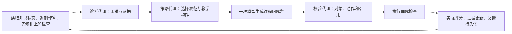

# 学脉第三代教学方法

四项方法使用同一课程、学生和学习证据模型。以下给出当前实现的定义与验证条件。对照数值来自 `scripts/validate_methods.py` 的隔离合成案例，结果保存在 `docs/rounds/第三轮核心方法对照.json`，不作为真实学生学习增益的估计。

## K-TRACE：相关性修正的多维知识证据追踪

问题：固定加减分无法区分独立完成、提示完成、部分得分、同题重复和密集变式。同一知识点短时间大量相近题目也不应被当作完全独立的证据。

输入：知识参数、题目难度、所测技能、提示次数、实际得分、发生时间、同题历史、24小时内同知识同技能的其他作答数。输出：后验均值、近似区间、有效证据量、证据质量、权重及复习安排。

设先验为 $(\alpha_0,\beta_0)=(1,3)$，距上次有效证据 $d$ 天，半衰期30天：

$$r=2^{-d/30},\quad \bar\alpha=1+(\alpha-1)r,\quad\bar\beta=3+(\beta-3)r.$$

设难度权重 $b\in\{1,1.4,1.8\}$、提示次数 $h$、得分比例 $s\in[0,1]$、同技能其他题近期作答数 $m$。独立性质量及更新权重为：

$$q=\frac{s}{1+h},\quad c(m)=\frac{1}{\sqrt{1+0.4m}},\quad w=b\,n\,c(m).$$

其中，同题间隔不足24小时，已答对且再次答对取 $n=0$，其他重试取 $n=0.35$；超过窗口或首次作答取1。后验与有效证据更新：

$$\alpha'=\bar\alpha+wq,\quad\beta'=\bar\beta+w(1-q),\quad p=\frac{\alpha'}{\alpha'+\beta'},\quad N'=rN+w.$$

模型用Beta方差给出截断到0–1的近似区间；小样本区间用于表达信息量，不是校准后的置信保证。无有效证据的先验保留在计算中，界面标为“待学习/待观测”，不计入已观测知识均值。概念、步骤、推理、迁移分别保留题目技能与表现摘要；先修缺口用于诊断，不直接降低后续知识的作答估计。

复习沿用质量等级与间隔递增调度。观看与实验操作记录不会被转换成独立成功。教师主观评阅使用实际百分制分数更新质量；60分的业务及格线不把65分、100分都转换为满分证据。

实现：`backend/app/evidence.py`；业务入口：`learning.record_attempt` 与 `routes_practice.teacher_review`。

验证：二级独立题权重1.4；同技能已有8次近期其他作答后权重0.68313。相同先验下，独立正确后验0.44444，两次提示正确后验0.27160。65分主观题质量为0.65。同题重复成功不增加证据、不刷新有效时钟。测试覆盖时间折减、间隔复习、部分得分及重复作答。

适用条件：课程题目需准确标注技能和难度，题目答案映射由教师核对。当前参数是工程中的显式配置，尚未用真实班级数据校准。

## PATH-G：先修约束的多目标学习路径规划

问题：只按薄弱程度或目标相关性排序，会把尚未准备好的后续内容排在前面，也不能明确控制当次学习时长。

输入：知识DAG、K-TRACE状态、活动候选、到期复习、错题、个人目标和教师任务、30分钟预算。输出：当次路径、预计用时、分项目标效用、搜索展开量和后续顺序。

知识点已具备准备状态的条件为 $N_k\ge2\land p_k\ge0.6$。路径 $P=(k_1,\dots,k_t)$ 满足：

$$\sum_i c_{k_i}\le B,\quad\forall v\in\mathrm{parents}(k_i),\ v\in\mathrm{ready}\ \lor\ v\in\{k_1,\dots,k_{i-1}\}.$$

前置活动排在前面表示执行顺序，不能据此声称前置知识已经学会；学生作答后系统重新计算路径。无可评分练习的知识点不生成练习候选。

每个候选的六个效用分量：

$$U_k=4(1-p_k)+1.5(u_k-l_k)+3G_k+3T_k+2D_k+\min(3,M_k).$$

其中 $G,T,D$ 分别为关联个人目标、教师任务、复习到期，$M$ 为未订正错题数。路径目标：

$$J(P)=\sum_{i=1}^{t}\left(0.92^{i-1}U_{k_i}-0.06c_{k_i}\right).$$

搜索保留24条束候选，最多扩展 $\min(|K|,\lfloor B/4\rfloor)$ 层。按效用、成本和知识ID确定稳定顺序。结果区分当次计划与后续候选，并保留效用分项，目标或学习状态改变后重新规划。

实现：`backend/app/path_planner.py`；接入：`learning.recommendations`。推荐数据批量读取，避免每个节点重复查询资源、题目、复习与状态。

验证：六节点分叉汇合DAG、6个目标、4种预算，共24例。PATH-G先修顺序违规0次、预算违规0次；按目标优先的静态排序有20个违规步骤。双分支例子中，目标从2变为4，16分钟路径从 `[1,2]` 改为 `[3,4]`。

适用条件：课程先修结构需可靠。有限束宽不是全局最优求解器，当前用时是活动估计；后续可用实际耗时进行校准。

## DIA-GUIDE：诊断—干预—校验的协作教学编排

问题：普通单轮回答缺少明确的教学对象、可执行动作与理解结果回流，无法可靠地根据学生反馈改变后续教学。

本实现为混合代理编排：规则诊断代理、消费诊断状态的一次语言模型教学生成、规则校验代理。三个角色不等同于三次模型请求，每轮最多一次模型调用。

共享状态 $S=(E,D,P,V,F)$：证据、诊断、策略、校验、理解反馈。状态转换：



诊断优先识别先修缺口，然后结合证据、提示依赖与错误类型形成教学关注；策略代理选择概念对照、渐进提示、实验或独立检查。前次同知识检查失败时优先改为实验表征，若该知识没有实验能力则回到可用概念对照。

校验代理只接受课程内候选动作，对检查ID、动作类型及引用编号进行核对。模型不能提交任意URL、成绩修改或额外能力；异常引用从最终成稿移除。前端最终以已校验内容替换流式临时文本。`teaching_runs` 保存角色输出、工具名、动作和检查反馈，不保存模型内部推理。

实现：`backend/app/teaching_agents.py`、`teaching_actions.py`、`ai_routes.py`；界面：`TeachingActions.tsx`。结构化协作轨迹可展开查看，检查结果继续驱动学习证据与下一轮策略。

验证：Mock端到端用例检查三个角色顺序、可执行检查、持久状态、失败反馈和下一轮实验策略。正式DeepSeek抽样也验证了三个角色协作、有效动作、理解检查与引用校验。与不产生动作对象的普通文本回答相比，该方法的关键改进是业务执行与反馈状态，不以文本长度或模型数量评价效果。

适用条件：当前诊断以可检查规则实现，难以覆盖开放性的所有误解；真实模型解释质量仍需结合教师检查。

## CLASS-LOOP：基于错因距离的动态教学分层

问题：同样的总分可能对应不同困难，固定分数档无法给出相匹配的教学任务。

输入：最近14天概念、步骤、推理、迁移的失分比例，提示使用比例，以及最近有效作答间隔；输出：临时群组、代表学生、主要关注、离散度、匹配题目和目标学生集合。

六维向量 $x_s=(e_c,e_p,e_r,e_t,h,a)$，缺少某类作答时错误比例取中性值0.5，参与间隔 $a=\min(1,\Delta d/14)$。加权距离：

$$d(s,t)=\sum_j w_j|x_{sj}-x_{tj}|,\quad w=(1.2,1.2,1.0,1.1,0.8,0.7).$$

采用确定性的最远点初始化和最多12轮k-medoids更新，最多4组，目标是降低组内距离之和。组名取群组平均向量中最突出的教学关注；匹配题目优先相应技能，其次按难度距离排序，从当前课程的已审核题中选出3题。教师确认后沿正常作业接口发布，作答与任务基线进入原有跟踪流程。

实现：`learning_insights.dynamic_groups`，接入教师分析、知识矩阵和群组任务表单。每次请求按当前证据重新计算，不将群组写成学生永久标签。

验证：同分但概念错因和步骤错因不同的四人案例被分为 `{1,2}` 与 `{3,4}`；改变学生2的证据后，归组变为 `{2,3,4}`。28人样本的学生正确率有22种值，动态分组覆盖全部28人。学情投影用5条SELECT完成，1846条已评分样本单次测量48.32毫秒；这是一台本机上的一次测量，不是性能上限。

适用条件：短期数据少时群组较不稳定，教师应结合课堂观察确认任务。聚类不直接证明学习效果。

## 运行验证

```powershell
.venv/Scripts/python.exe -m pytest backend/tests/test_algorithms_v3.py backend/tests/test_evidence_math.py -q
.venv/Scripts/python.exe scripts/validate_methods.py
node frontend/scripts/verify-graph.mjs docs/rounds/第三轮图谱几何测试.json
```

正式产品有后端密钥时使用DeepSeek；上述命令的真实AI请求为0。独立的真实联调报告记录本轮4次正式端点抽样，历史账本保留。研究背景与相关方法见正式技术文档参考文献。
