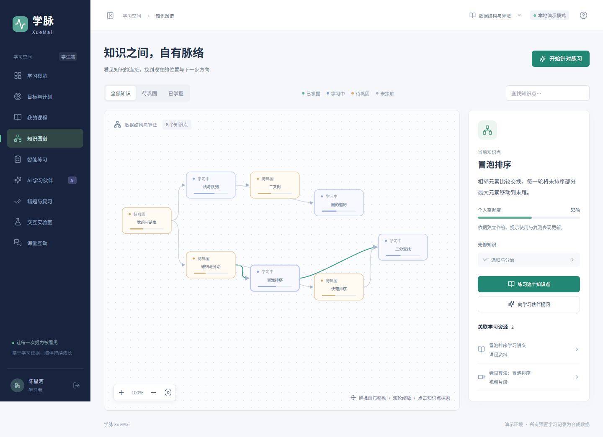
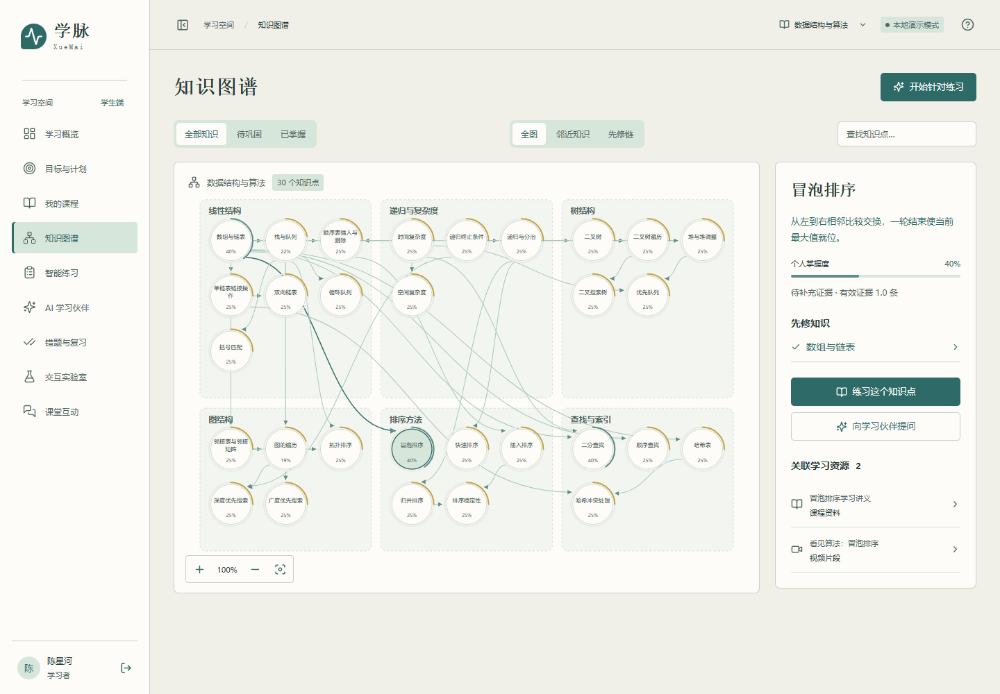
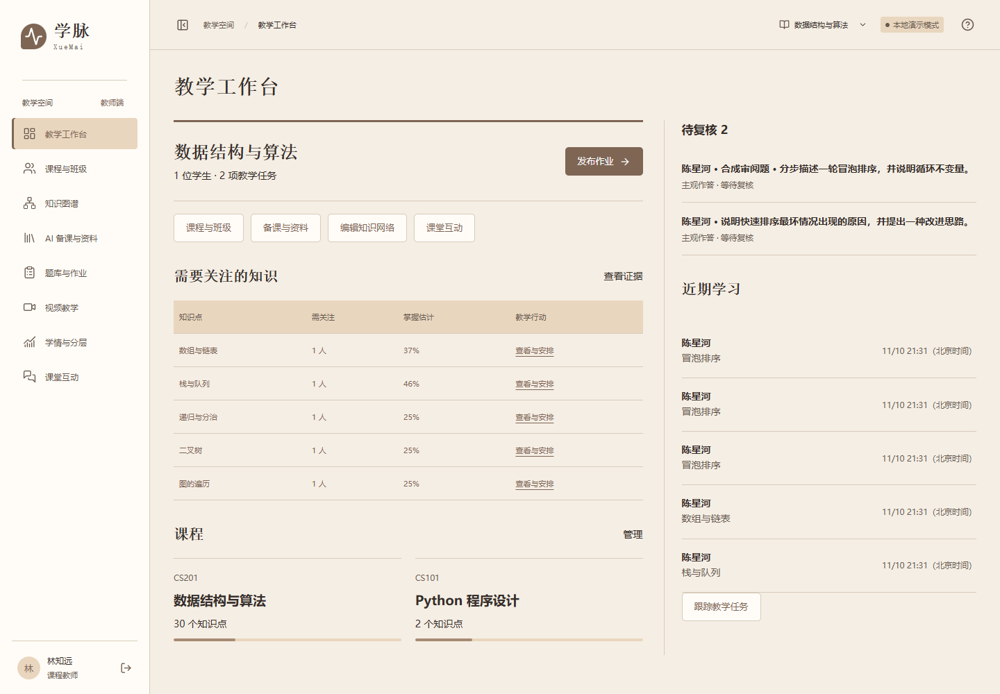

# 双端配色与组件映射

学生界面以任务、课程和知识网络为主体，教师界面以待批改证据、课程组织和干预跟踪为主体。标题采用宋体衬线，正文使用系统无衬线字体。共用中性登录页、控件尺寸、焦点规则和间距，角色进入后使用对应主题。

| 来源 | HEX | Token | 实际用途 |
|---|---|---|---|
| 宋瓷青绿08/20 | #2E6A67 | --brand-primary | 学生主按钮、选中导航、图谱关键关系 |
| 宋瓷青绿08/20 | #5E8C87 | --brand-secondary | 学生进度、次级轮廓 |
| 宋瓷青绿08/20 | #A9C8BE | --brand-soft | 图谱群组、悬浮边界 |
| 宋瓷青绿08/20 | #D7E6DB | --surface-subtle | 学生选中行、轻背景 |
| 宋瓷青绿08/20 | #F1F0E8 | --surface | 学生页面背景 |
| 茶烟米褐05/20 | #7E6554 | --brand-primary | 教师主操作、编辑态 |
| 茶烟米褐05/20 | #A78A73 | --brand-secondary | 教师次级轮廓、数据序列 |
| 茶烟米褐05/20 | #D4B79D | --brand-soft | 教师选中区域、次级图表 |
| 茶烟米褐05/20 | #E9D6BE | --surface-subtle | 教师辅助工作区 |
| 茶烟米褐05/20 | #F5EEE4 | --surface | 教师页面背景 |
| 月白松烟09/20 | #F7F6F2 / #E8E9E6 | --neutral / --border-neutral | 登录、共用表单、分隔 |
| 雾蓝银灰02/20 | #607E95 / #A8C3D6 | --data / --data-soft | 独立数据系列 |
| 槐黄石绿04/20 | #C6A348 | --accent | 复习到期和里程碑 |
| 墨红金沙03/20 | #8C2F2D | --danger | 错误、删除 |

正文分别使用#263A37和#352D29，主按钮使用白字。浅色板承担背景和图形层次，正文与表单标签使用深色中性值。选中、到期、未接触等状态同时保留文字、环形进度或描边。源码主题配置见frontend/src/styles/tokens.css。

## 实际对比度核算

2026年11月10日执行`python scripts/check_design_contrast.py`，使用sRGB相对亮度和WCAG对比度公式。下表为当前关键组合，普通文字目标不低于4.5；不将局部通过解释为整站无障碍认证。

| 角色 | 正文/底色 | 辅助文字/底色 | 白字/主按钮 | 深墨数字/浅色柱条 |
|---|---:|---:|---:|---:|
| 学生 | 10.54 | 5.36 | 6.22 | 6.71 |
| 教师 | 11.70 | 5.74 | 5.42 | 7.10 |

实验浅色柱条曾使用白色数值，已改用角色正文色。原五色板不变，深色文字承担可读性。机器可读结果见[design-contrast.json](design-contrast.json)。

## 改版前后

| 位置 | 原版 | 当前实现 |
|---|---|---|
| 登录 | 深蓝大面积装饰与三个体验入口 | 中性纸白、明确表单、学生与教师两个入口 |
| 学生工作台 | 数据卡与多组说明 | 下一任务、推荐原因、课程与近期活动 |
| 教师工作台 | 与学生首页近似 | 课程操作、待评阅作答、具体困难与教学任务 |
| 图谱 | 约8个矩形节点、固定坐标 | 30圆环节点、六簇自动布局、曲线方向、先修聚焦与详情 |
| 学习工作区 | 重复卡片与较重装饰 | 练习聚焦作答，视频突出播放器与时间线，资料采用列表 |
| 学情 | 聚合指标优先 | 知识点与作答证据相邻，连接定向任务和结果对照 |

完整截图覆盖1440×1000、1366×768、1920×1080与390×844。登录和实验窄屏溢出、课堂回答回看已修正。手机查看30节点全网时字号较小，需要搜索、聚焦与缩放；长资源和学情列表保留分段图供继续检查。
